# MOE-v2: seeing the target, a movement expert and a stuck-escape expert, and a chain that does not repeat a failure (2026-11-09)

`TASK-20261109-046`, second part. The first part ([MOE-v1](MOE-v1.md)) learned the crafting experts almost perfectly and failed at the ore: `coal` 0.67, `raw_iron` 0.68 held-out, and a learned chain that reached the iron pickaxe in 3 % of `chain-placed` episodes against 43 % for the scripted chain. This document records the owner's explanation (the ore is simply not visible), what was built to test it, the pre-registered predictions, and what the numbers say. Nothing here ran on the real Forge server.



(The picture is `docs/diagrams/moe-v2-architecture.svg`. Dashed lines are what an expert may see, solid lines are control flow, red is the stall reflex.)

## Why v1 failed at the ore: two causes, one of them a bug

1. **Visibility (the owner's hypothesis, 2026-11-09).** In v1 an expert saw a 9x9x5 block grid, a fan of 128 rays reaching 24 blocks, and a `mine` list limited to 10 blocks. Ore 6-16 blocks away, behind a hill, or underground was not in the observation at all; the one measurement in v1 that varied the distance (`raw_iron`, ore 2-6 blocks: 0.99, 6-16 blocks: 0.44, scripted solver 0.67 there) fits this. The scripted solver was hurt by the same limit, which is why the "ceiling" of the rule system (43 %) was low as well.
2. **A defect in the chain (found by tracing, 2026-11-09).** The router asked again every time an expert's 150-step budget ran out; with an unchanged pack it returned the same expert and the greedy policy repeated the same behaviour. Traces of the learned chain show `raw_iron` called up to six times in a row with an identical pack (6 x 150 = the whole 900 budget). The earlier guess "crafting tables are consumed and re-crafted" was tested and is false: `crafting_table` stays at 1 in the pack after placing.

## What was built

| Part | Where | What |
| :-- | :-- | :-- |
| Target scan | `tools/sim/src/scan.rs`, `obs.rs` | For five groups (`log`, `coal`, `iron`, `way` = the scenario's waypoint, `sky` = the standing cell on top of the nearest highest column) the 3 nearest cells within 4 chunks of the bot's chunk, hidden or not, as vectors; per candidate the progress it makes toward the nearest cell of each group; **scan moves** (`move_to` toward the nearest target of a group, to the reachable cell nearest to it, flagged in `cand_feat[7]`). Switched on by the scenario key `scan`; without it nothing changes. Privileged on purpose (owner 2026-11-09, the RL part is separated from research); the real bot has every block of its loaded chunks, so the same scan can be made from the client's chunk data. |
| Scenario keys | `scenario.rs` | `waypoint` (`dist`, `bearing`, `detour` N = the longest-walk of N candidates, `depth` = inside the rock under a walkable cell), `trap` (`shaft` or sealed `pocket`, 3-40 blocks under the surface; the waypoint is the cell the bot started from), `end.reach`. 33 Rust tests. |
| Relevance | `moe/features.py`, `catalog.json` | The router names the groups that matter for the expert it calls; the expert gets the 4 nearest cells **of those groups** (vector, distance, group) plus the progress column, and nothing of the others. |
| Skill experts | `catalog.json` | `move` (walk to the shown target: open ground 6-64 blocks, longest-detour of 12, a waypoint 4-12 blocks inside the rock so the way is dug) and `unstick` (out of a shaft or a closed pocket; precondition a pickaxe). Called at any time, make no item. Budgets 1.5 M and 1.2 M steps, stop at 0.99 / 0.985 over 200 episodes. |
| Router | `moe/rules.py`, `router.py` | Inputs now: pack, goal, blocks to the nearest log/coal/iron (65 = none within 4 chunks) and `stalls`. Rules: a target farther than 6 blocks sends `move` first; 2 stalls send `unstick`. XGBoost/LightGBM copy the rules (labels from the rules, never from counterfactual rollouts). |
| Chain | `moe/chain.py` | **Stall reflex**: a call that ended without a change of pack or a 3-block step toward its target is a stall; the next call samples from the policy instead of the greedy action; after two stalls `unstick` is called. `--greedy-stall` reproduces the v1 behaviour as a control. |
| PC runner | `scripts/moe/pc.sh`, `scripts/moe/pc/jobs.py` | Runs everything in WSL2 on the owner's PC without docker (probe, install, run, status, peek, pull, stop). |

## Protocol (fixed before any v2 expert was trained)

Held-out worlds `vps-s3`, `vps-s4`, 200 episodes per scenario, Wilson 95 % intervals, scripted-solver and uniform-random controls on the same scenarios, success = the simulator's own `outcome`, as in v1.

Positive controls measured before training (VPS, 60 episodes, scripted solver; the scan makes the tasks solvable):

| Scenario | Solver success | Commands | Note |
| :-- | --: | --: | :-- |
| `raw_iron` (ore 2-48 blocks) | 0.90 | 62 | v1, ore 2-16 blocks, no scan: 0.80 |
| `coal` (ore 3-48 blocks) | 0.95 | 31 | v1: 0.77 |
| `move` (open ground 6-64) | 1.00 | 2.2 | |
| `move-detour` (longest walk of 12) | 1.00 | 3.9 | the tiles have few obstacles; see limits |
| `move-dig` (waypoint 4-12 in the rock) | 0.95 | 8.7 | |
| `unstick` shaft / pocket | 0.65 / 0.63 | 66 / 68 | |

**Predictions.** P1 (visibility): with the scan the learned `raw_iron` and `coal` pass the v1 claim (Wilson lower bound >= 0.80 and above random) at ore distances 2-48, where v1 without the scan failed at 2-16; and match the solver. P2 (reflex): the learned chain with the stall reflex beats the same chain with `--greedy-stall` on `chain-placed`; the router kind (rules / XGBoost) does not matter, as in v1. P3: movement reaches >= 0.99 on open ground. If P1 fails the next suspect is the observation of the candidates and the reward shaping, not the amount of training.

## Results

All numbers: the Rust simulator, held-out worlds `vps-s3`/`vps-s4`, Wilson 95 % intervals in brackets, training, evaluation and controls on the owner's PC (WSL2, CPU only, 16 threads at nice 10; 2026-11-09 19:30 - 22:30 JST); only the positive controls of the protocol table above were measured earlier on the VPS. Experts: `p7` (standard stop rule, 0.97-0.985 over 200 episodes) with `p7h` (stop at 0.995 over 500 episodes) for `move`, `unstick`, `coal`, `raw_iron`; the full tables are generated by `python -m moe.report` (`/mnt/data/forgeaip/moe2/reports/`). The final experts are in `/mnt/data/forgeaip/moe2/pc-runs/c4/c4/<expert>/final.npz`.

### 1. The visibility hypothesis (P1): the same scenario with and without the scan

Same ore placement (3-48 blocks on the surface), same budget rules; the "no scan" runs use the v1 observation (`scan: false`, no scan moves).

| Expert | Observation | Steps | Held-out, learned | Scripted solver | Uniform random |
| :-- | :-- | --: | :-- | :-- | :-- |
| `coal` | v1, no scan | 600,000 (budget, not solved) | 0.65 [0.58, 0.71] | 0.71 [0.64, 0.77] | 0.09 |
| `coal` | scan | 49,154-69,640 | **1.00 [0.98, 1.00]** | 0.95 [0.92, 0.98] | 0.15 |
| `raw_iron` | v1, no scan | 800,000 (budget, not solved) | 0.20 [0.15, 0.27] | 0.56 [0.50, 0.63] | 0.01 |
| `raw_iron` | scan | 57,359-102,425 | **0.95 [0.92, 0.98]** | 0.94 [0.89, 0.96] | 0.04 |

(v1, ore 3-16 blocks, no scan: `coal` 0.67, `raw_iron` 0.68, solvers 0.77 / 0.80.) The scan raises the learned expert from 0.65 / 0.20 to 1.00 / 0.95 and the scripted solver from 0.71 / 0.56 to 0.95 / 0.94 on the same task, in about a tenth of the steps, so what limited the experts was what they could see, not the learner, the budget or the reward. The ablation changes the observation and the shaping that uses the scan together; a run that keeps the scan features and drops only the shaping was not made.

### 2. The experts (final: `p7`, hard runs `p7h` for the four named above)

| Group | Experts | Held-out, learned | Solver / random |
| :-- | :-- | :-- | :-- |
| Crafting, wood, stone, smelting (15 item experts incl. the new `wooden_sword`, `stone_sword`, `torch`) | `log` ... `torch` | 0.97-1.00 each; lower bounds >= 0.94 | solvers 0.92-1.00, random 0.01-0.77; `cobblestone` 0.99 in 8.4 commands (solver 0.92 in 20.5) |
| `coal` surface / buried / natural | ore 3-48 blocks / 2-24 blocks under the surface / real ore within 4 chunks | 1.00 [0.99, 1.00] / 0.99 [0.98, 1.00] / 1.00 [0.99, 1.00] | solver 0.95 / 0.88 / 0.91 |
| `raw_iron` surface / buried / natural | same | 0.95 [0.92, 0.97] / 0.98 [0.96, 0.99] / 0.92 [0.89, 0.95] | solver 0.88 / 0.88 / 0.82 |
| `move` open ground / longest detour of 12 / waypoint inside the rock | 6-64 blocks / 12-64 / 6-40 blocks and 4-12 deep | **1.00 [0.98, 1.00] / 0.98 [0.96, 0.99] / 0.98 [0.95, 0.99]** (300 episodes) | solver 0.99 / 0.97 / 0.94, random 0.71 / 0.58 / 0.18 |
| `unstick` shaft / sealed pocket | 3-24 blocks under the ground | 0.98 [0.95, 0.99] / 0.98 [0.96, 0.99] (hard run); 0.99 / 0.99 (standard run) | solver 0.99 / 0.99, random 0.31 / 0.26 |

The learned ore experts need 6-14 commands where the scripted solver needs 30-90. The failures of `raw_iron` are mostly deaths (12 of 300 on the surface, 19 of 300 on natural ore against 4 and 4 timeouts): a zombie, skeleton or creeper ends the episode (`die: true`). No expert fights or flees; that is a survival reflex that v2 does not have.

### 3. The chain (P2)

Router + experts as one policy, goal iron pickaxe from a plain start, 900 commands, 3 in-game days, 200 episodes per row. `placed` = coal and iron placed on the surface 4-40 / 6-48 blocks away; `natural` = the start must have coal and iron within 4 chunks and nothing is placed.

| Router | Experts | Stall handling | `chain-placed` | `chain-natural` |
| :-- | :-- | :-- | :-- | :-- |
| rules | learned (final) | sample, then `unstick` | **0.96 [0.92, 0.98]** (8 timeouts) | **0.90 [0.84, 0.93]** (21 timeouts) |
| rules | learned (final) | greedy repeat (the v1 behaviour) | 0.75 [0.69, 0.81] | 0.65 [0.58, 0.71] |
| rules | scripted solvers | sample, then `unstick` | 0.91 [0.86, 0.94] | 0.83 [0.78, 0.88] |
| XGBoost (DAgger on the training worlds only) | learned (final) | sample, then `unstick` | 0.945 [0.90, 0.97] (seed 31) | 0.89 [0.84, 0.93] (seed 31) |
| rules, same seed 31 | learned (final) | sample, then `unstick` | 0.90 [0.85, 0.93] | 0.855 [0.80, 0.90] |
| v1 (for reference, MOE-v1) | learned | greedy repeat | 0.03 | 0.00 |

The learned chain is at least as good as the scripted chain (which now also has the scan and the reflex), and the stall reflex is worth 21 and 25 points (non-overlapping intervals). Rules and the XGBoost router are within sampling noise of each other (two seeds of the rules chain differ by 0.06). **P2 holds for the reflex; for the router it needed a fix** (below). Every one of the 21 failing `natural` episodes contains 1-6 deaths (the chain restarts from an empty pack inside the 900 commands); 75 of the 200 successful ones also contain a death. Deaths are the limit that is left.

### 4. What the sequence of fixes was (each step measured on `chain-placed` / `chain-natural`, 100-150 episodes)

| Step | Rules router | XGBoost router | What was found |
| :-- | :-- | :-- | :-- |
| first v2 experts + stall reflex | 0.85 / 0.82 | 0.01 / 0.00 | the router had never seen packs with 76-261 cobblestone (counts from digging), the trees extrapolated and sent the chain to `move` for hundreds of steps |
| router trained on digging leftovers and simulated chain states | | 0.80 / 0.73 | disagreements with the rules: late-stage states (after `iron_ingot`, wood is missing again), `done` too early |
| + `seen` column (memory of recent destinations), all experts retrained | 0.85 / 0.70 | 0.77 / 0.74 | |
| + action spaces per expert and the distraction filter, all retrained | **0.97 / 0.87** | 0.82 / 0.69 | traces of failing episodes: the log expert mined coal ore; the movement expert placed and mined a furnace for hundreds of steps; sampled experts crafted torches out of the sticks they needed (none of these candidates occurred in training) |
| + DAgger (states the XGBoost chain visits, labelled by the rules), 2 rounds | | **0.95 / 0.91** | the standard fix for the shift between the states a router is trained on and the states its own mistakes lead to |

The `seen` column did not move the chain measurably (placed 0.85 with and without it). On the hard movement scenarios (detour / dig, held-out) the runs read 0.93 / 0.945 (first run), 0.95 / 0.96 (stricter stop rule, no `seen`), 0.96 / 0.97 (stricter stop rule + `seen`), 0.98 / 0.98 (+ masks): the stop rule, `seen` and the masks each may contribute and are not separated.

## Checks against the predictions

- **P1 (visibility)**: holds, section 1. Not shown: that the scan is the *only* thing that matters (the shaping and the scan moves came with it).
- **P2 (reflex, router)**: the reflex holds (0.96 vs 0.75, 0.90 vs 0.65); "the router kind does not matter" held in v1 and failed in the first v2 run until the router was trained on the states it visits.
- **P3 (movement >= 0.99 on open ground)**: holds, 1.00 [0.98, 1.00]. On detours and digging 0.98; the scripted solver is at 0.94-0.97 there, so the remaining 2 % are mostly cliffs and ponds that the straight-line moves of the candidate list cannot round.

## What this does not show

- **Not the real game.** The simulator is lenient (SIM-RUST-v1 section 10: mining 2.8x too fast, placements never fail, 5x too safe, damage about 0.65x). The scan assumes the bot knows where ore is within 4 chunks: the real bot has every block of its loaded chunks, but nothing here ran on the Forge server, and `skill_space.js` has no scan moves yet.
- **The terrain is mild.** `move-detour` picks the longest walk of 12 candidates and the solver still gets 0.97: the tiles have few obstacles. Movement across lakes, ravines or lava is not tested.
- **Deaths dominate what is left** and are not addressed: no fight, flee, eat or sleep expert.
- **Router data.** The first DAgger rounds used states from the held-out worlds (labelled by the rules, no outcomes). The reported XGBoost numbers come from a second router trained only on states of the training worlds `vps-s0..s2` and evaluated on `vps-s3/s4`.
- **Seeds.** One training seed per expert and one evaluation seed per chain row except where two are given; seed-to-seed differences of the chain are about 0.05.
- **No monolithic control** (one goal-conditioned model on the same starts): "the split works" is shown, "the split is better" is not.
- **The PC's GPU was not used.** The policies have 40 k parameters and the cost is the simulator and the Python feature code (about 3.4 ms of simulator CPU per step); all runs were CPU.
- **Interpretation of the instruction.** "Half of all goal candidates" was read as 15 of the 30 catalogue items as goals (12 earlier + `wooden_sword`, `stone_sword`, `torch`), plus the two skill experts; "the same 10 as the previous run" as the previous 12 item experts.

## Run

```bash
scripts/moe/pc.sh install                       # simulator binary, moe package, scenarios -> ~/moe in WSL on the PC
scripts/moe/pc.sh run p7 train --tag p7 --experts all --par 6 --controls 1 --episodes 200
scripts/moe/pc.sh run p7h train --tag p7h --experts move,unstick,coal,raw_iron --par 4 --hard --controls 1 --episodes 300 --seed 1
scripts/moe/pc.sh run asm assemble --into c4 --sources p7,p7h ; scripts/moe/pc.sh run rt router --tag c4
scripts/moe/pc.sh run ch chain --tag c4 --scenario chain-natural --router rules --experts net --episodes 200 --seed 21 [--greedy-stall] [--worlds vps-s0,vps-s1,vps-s2 --dump-states s1.jsonl]
scripts/moe/pc.sh report c4 ; scripts/moe/pc.sh pull c4 ; scripts/moe/pc.sh stop
scripts/moe/test.sh                              # 27 unit tests (docker, no simulator); tools/sim: cargo test (34)
```
